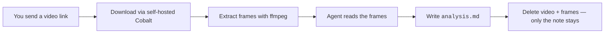

<p align="center">
  <h1 align="center">🎬 Video Watcher</h1>
  <p align="center">An AI agent skill for <i>watching</i> videos &amp; reels — without ever playing a video.</p>
  <p align="center">
    <a href="https://github.com/neartana/video-watcher/blob/main/LICENSE"></a>
    
    
    
  </p>
</p>

Your agent can't play video or hear audio. **Video Watcher is the workaround:**
download the video, slice it into frames, let the agent *read* the frames,
then save the reading as a Markdown note — and delete the video so only the
notes remain.

## ✨ Install

Pick one — both do the same thing:

```bash
# Option A: via the skills CLI (Muse, Claude Code, Cursor, …)
npx skills add neartana/video-watcher

# Option B: direct installer, no skills CLI needed
npx github:neartana/video-watcher
```

Then check it landed:

```bash
ls ~/.agents/skills/video-watcher   # or ~/.claude/skills/video-watcher
```

## 🧠 How it works



| Step | What happens |
| ---- | ------------ |
| **1. `get`** | Download via local Cobalt API, extract ~20 evenly-spread frames + `audio.mp3` |
| **2. read** | The agent opens every frame and notes what it sees, with timestamps |
| **3. `finalize`** | `analysis.md` is filed into the notes library; the run dir (video, frames, audio) is deleted |

```bash
# 1. download + extract frames (prints a JSON manifest)
python3 scripts/watch_video.py get 'https://www.instagram.com/reel/…' --max-frames 20

# 2. agent reads the frames, writes <workdir>/analysis.md

# 3. file the note, wipe the video
python3 scripts/watch_video.py finalize <workdir>
```

Every run produces a note like this:

```md
# Leer manga con MeikiPop
- Source: https://www.instagram.com/reel/DesD1VMzb3Q/
- Duration: 42.5s · Read on: 2026-10-20

## What happens
0.0s — Phone screen shows a manga reader app…
…

## On-screen text
"LEER MANGA CON MEIKIPOP"

## Apps / products / brands identified
MeikiPop — visible at 0.0s
```

## 📦 Requirements

| Tool | Why | Notes |
| ---- | --- | ----- |
| Python 3.8+ | runs `watch_video.py` | stdlib only — no pip packages needed |
| `ffmpeg` + `ffprobe` | frame extraction, duration probing | `brew install ffmpeg` / `apt install ffmpeg` |
| Node 18+ | runs the Cobalt server | only needed for URL downloads |
| Cobalt (self-hosted) | turns page links into direct video URLs | `imputnet/cobalt` — the public `api.cobalt.tools` now requires a JWT |

The script looks for Cobalt source at `~/workspace/tools/cobalt-src/api` and
serves it at `http://localhost:9000/`, auto-starting it if it's down.
Point it elsewhere with `VIDEO_WATCHER_COBALT_DIR`.

## ⚙️ Configuration

All paths can be overridden with environment variables; defaults just work
on a fresh install.

| Variable | Default | Purpose |
| -------- | ------- | ------- |
| `VIDEO_WATCHER_HOME` | `~/workspace/video-watcher` | runs/ + notes/ library root |
| `VIDEO_WATCHER_COBALT_DIR` | `~/workspace/tools/cobalt-src/api` | Cobalt API source dir |
| `VIDEO_WATCHER_COBALT_URL` | `http://localhost:9000/` | Cobalt API endpoint |

Notes library: `$VIDEO_WATCHER_HOME/notes/*.md` — permanent.
Temporary runs: `$VIDEO_WATCHER_HOME/runs/run-<timestamp>/` — deleted on finalize.

> ⚠️ Never run `finalize` before `analysis.md` exists — it deletes the only
> copy of the video.

## 🔍 What it's good at — and not

**Good at**
- "What happens in this reel?"
- "What app/product is shown on screen?"
- "What text appears in the video?"

**Not**
- Audio-only content (frames ≠ watching; the skill says so honestly)
- Cobalt-unsupported links — the error is reported plainly, then the
  fallback chain is: platform connector → live browser → ask for the file

## 📄 License

[MIT](LICENSE) — do whatever you want with it.

---

<p align="center">Built for <a href="https://muse.ai">Muse</a> agents. If it helped you, a ⭐ is the cheapest thank-you.</p>
